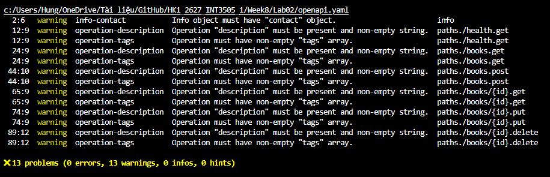

Kết quả chạy lint:

Custom rule đã áp dụng: Delete 204 no content:

delete-204-no-content:
  description: HTTP 204 must not contain a response body.
  message: HTTP 204 response must not contain content.
  severity: error
  given: "$.paths['/books/{id}'].delete.responses['204']"
  then:
    field: content
    function: undefined

Giải thích rule catch trường hợp nào: Kiểm tra response 204 No Content của API DELETE /books/{id}. Nếu response có trường content (khai báo response body), Spectral sẽ báo lỗi.